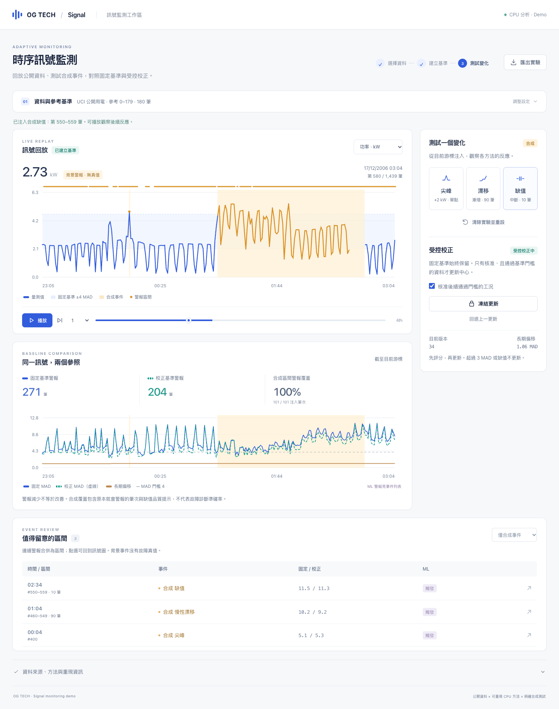

# Signal Adaptive Monitoring

modality=`signal` · application=`adaptive monitoring / PdM demonstration`

繁體中文、CPU 可跑的單頁時序監測工作區。以 UCI 真實公開資料回放與明確合成事件，體驗「資料 → 參考基準 → 異常提醒 → 受控校正」。可用於電力、製造、環控與設備監測的售前驗證，不暗示商業客戶關係，也不宣稱已接記錄器或能診斷真實故障。



## 本機執行

Python 3.12，建議 2 CPU / 1 GB RAM（部署建議，非硬體保證）。不需 GPU、API key、遠端模型或外部字型／CDN。

```sh
python3 -m venv .venv
.venv/bin/pip install -r requirements.lock
.venv/bin/uvicorn app.main:app --host 127.0.0.1 --port 8011
```

開啟 http://127.0.0.1:8011 。此為本機網址，不能當作客戶可從外網開啟的網址。不要占用其他專案的 8000 埠。

## 操作流程

1. **資料與參考基準**：預設載入 UCI 公開用電資料；也可選離線合成訊號，或匯入單一設備 CSV。檢查參考區間，核准展示工況後建立基準。這是操作員的參考選擇，不代表資料具有健康真值。建模後設定列收合；手機初始先呈現訊號預覽，點「核准參考」展開設定。
2. **訊號回放**：播放／暫停、10×／50× 快轉、逐筆或拖曳時間軸。圖表顯示目前及前 239 筆，可切換功率／電壓／電流。滑過圖表檢視真實數值；固定基準 ±4 MAD 為統計門檻，不是物理安全界線。
3. **測試變化**：從游標注入單點尖峰、90 筆漂移或 10 筆缺值。amber 曲線／區帶與事件列標明「合成」，不冒充來源量測或已知設備故障。
4. **受控校正**：核准後續工況、解除凍結，再觀察固定／校正分數。只接受不缺值、相對固定與校正中心均 <3 MAD 的樣本；固定基準、尺度與 ML 不變。凍結停止後續更新；回退撤銷上一個中心更新並凍結。操作記在游標時間點，修改過去會重播該實驗的控制時間軸。
5. **事件與匯出**：連續警報聚合為區間，可篩選合成／背景事件，點選或按 Enter 定位圖表。匯出 JSON 包含資料、合成標記、控制時間軸、模型參數、版本與種子，可重建實驗；匯出明示完整資料重播結尾模型與目前游標版本的不同範圍。清除實驗保留來源資料並清空模型、事件與核准；切換來源或修改參考區間也須重新核准。

原始 UCI 資料沒有故障真值，背景警報不能稱為真實 false positive。合成區間警報覆蓋包含原本就會警報的筆次與缺值品質提示，不能歸因為注入偵測成功；警報減少不代表改善。詳細分模型結果見 [CPU 實測](docs/benchmark.json)。

## 真實方法與適配邊界

- **固定基準**：NumPy median / MAD，多通道最大標準化偏差；閾值 4。缺值填不可變參考中位數，另外觸發品質警報並禁止更新，不使用未來插值。
- **ML**：scikit-learn IsolationForest，64 棵樹、單執行緒、seed 520。依時間以前 70% 參考資料訓練，後 30% 校準分數 98% 分位門檻；無故障標籤。ML 警報呈現在事件欄位，主比較圖聚焦固定／校正 MAD 與長期偏移。
- **受控基準校正**：中心以 0.025 步長更新，必須明確核准並通過不可變基準門檻；逐筆先評分再更新。這**不是 TTT，也不是 AutoML**，沒有自監督梯度訓練。長期偏移保留與不可變基準的距離。
- **資料介面**：`app.core.validate`、`/api/data` 與 CSV 匯入。CSV 欄位為 `power_kw,voltage_v,current_a`，80–20,000 筆；空白為缺值，依列順序，操作員需確認單一設備與時間順序。沒有時間欄時不杜撰取樣率或時間戳。來源切換重新建模，未做跨設備效能驗證。
- **重現**：匯出包含實作版本、scikit-learn/Python 版本、參考雜湊、基準、尺度、ML 門檻與種子；ML 可依參考資料重建，不輸出不安全的 pickle。每次 API 計算獨立，不儲存使用者 CSV 或 session。

## 合法資料與開源重用

內附 UCI 235 前 1,440 筆、一分鐘、三通道切片。作者 Georges Hebrail、Alice Berard，CC BY 4.0；[來源、授權、修改與 SHA256](data/ATTRIBUTION.md)。原資料是家庭用電，不是高速工業電流或故障資料。合成來源固定 seed 520。

```sh
# 可選：下載官方 archive（快取不重抓，驗證 SHA256 後產生切片）
.venv/bin/python scripts/download_uci.py
```

程式為 MIT；資料與上游授權各自保留。[scikit-learn](https://github.com/scikit-learn/scikit-learn) / [NumPy](https://github.com/numpy/numpy) / [Uvicorn](https://github.com/encode/uvicorn) 為 BSD 3-Clause；[FastAPI](https://github.com/fastapi/fastapi) 為 MIT。本 repo 不含客戶私有資料、金鑰、私有模型或原始提案。

## 測試與畫面

```sh
.venv/bin/python -m pytest -q
.venv/bin/python -m scripts.benchmark
# 另安裝 Playwright；使用已安裝 Chrome，先啟動 API
PLAYWRIGHT_MODULE=/tmp/signal-ui/node_modules/playwright node scripts/ui-test.cjs
PLAYWRIGHT_MODULE=/tmp/signal-ui/node_modules/playwright node scripts/ui-edgecases.cjs
```

可用 `DEMO_URL`、`CHROME_PATH`、`QA_OUTPUT` 指定本機測試目標、Chrome 與輸出目錄。UI 測試涵蓋 1440／768／390px 全流程；另驗 CSV、錯誤空態、hover、分析時禁用控制及來源切換取消過期回應。核心測試涵蓋凍結／回退、先評分後更新、無標籤介面、缺值與異常不更新、未來資料不影響過去、不可變基準、資料驗證及 API 重現。

[完整驗證紀錄](docs/VALIDATION.md) · [互動設計](docs/UI-REDESIGN.md) · [手機畫面](docs/ui-390.png)

## 部署與搬遷

已準備 Dockerfile、Compose 與 Linux amd64 覆寫。Docker context 為執行檔白名單，不攜帶 `.venv`、秘密、快取或影片。29 個鎖定依賴的 Linux amd64 wheels 已確認可取得，但本輪未驗證容器 build/run，不把 Mac CPU 結果當作 Linux 或 Genio 520 效能。

```sh
python3 scripts/package_migration.py
# 僅在核准主機完成盤點後執行；本機 loopback 綁定 8011
# docker compose -f compose.yaml -f compose.linux-amd64.yaml up --build -d
```

[Linux 搬遷與驗證清單](docs/MIGRATION.md)。沒有宣告資料 volume；API 無伺服端持久 session。對外服務應由核准反向代理／TLS／存取控制提供網址，不自動改 IAM、防火牆、SSH key 或路由。手動 workflow_dispatch preflight 只驗證識別字，不部署或購買資源。未部署 G520；新記錄器通道、取樣率、頻寬與 SDK 仍需確認。TypeSafe（Jev）僅為未來外部決策候選，沒有呼叫付費 API 或宣稱可下載權重。
